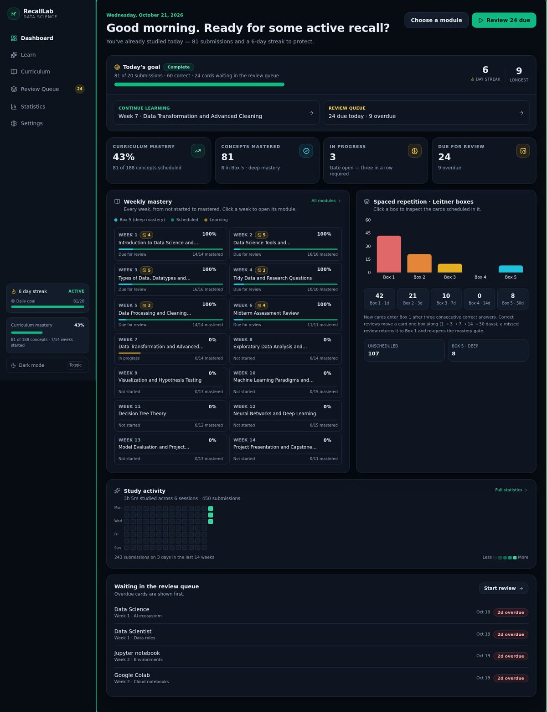
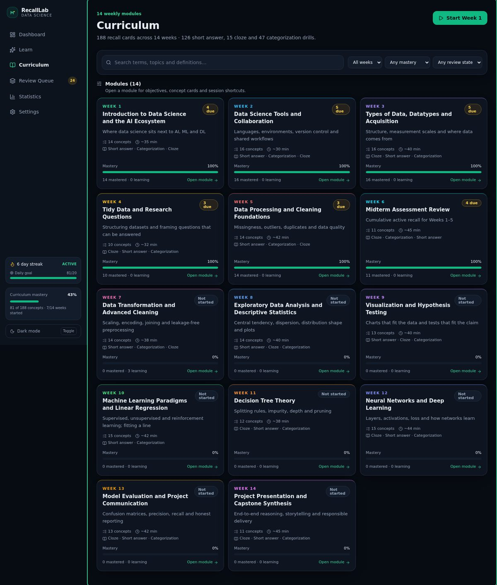
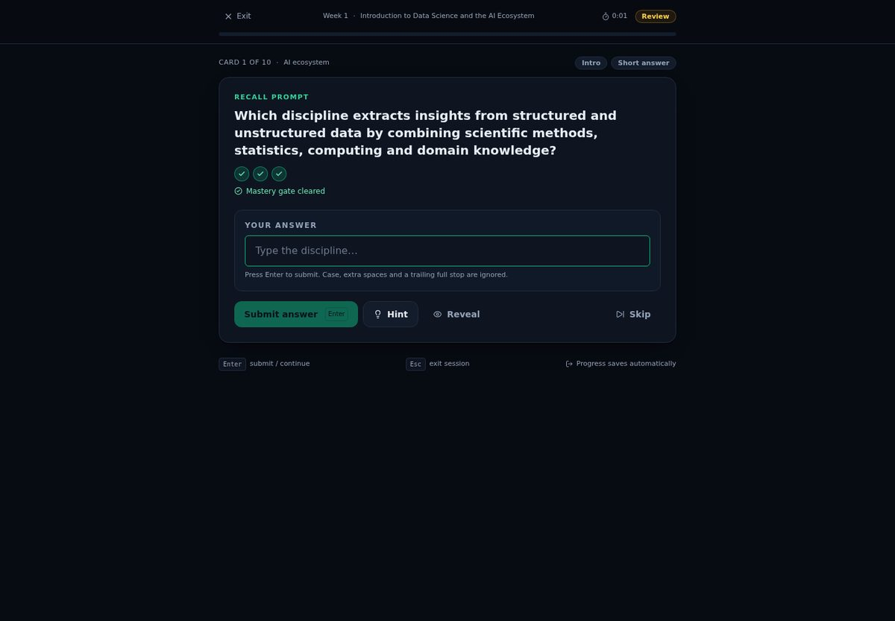
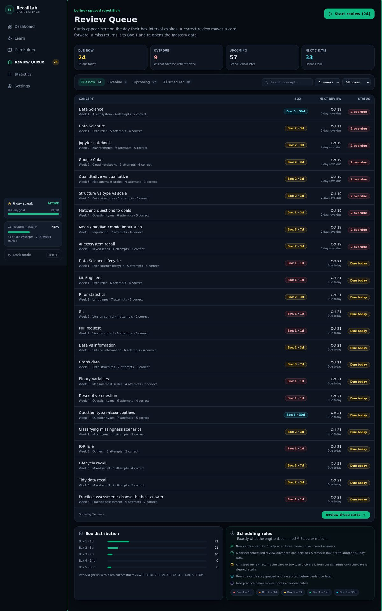
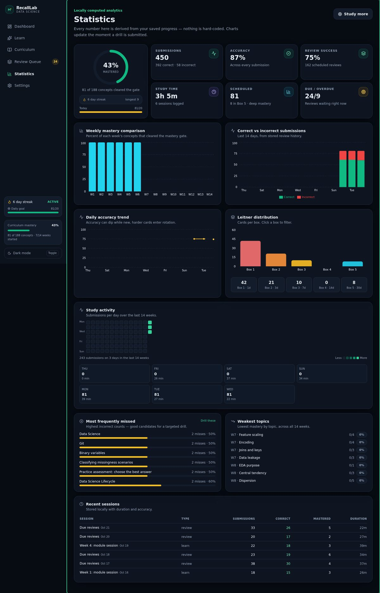
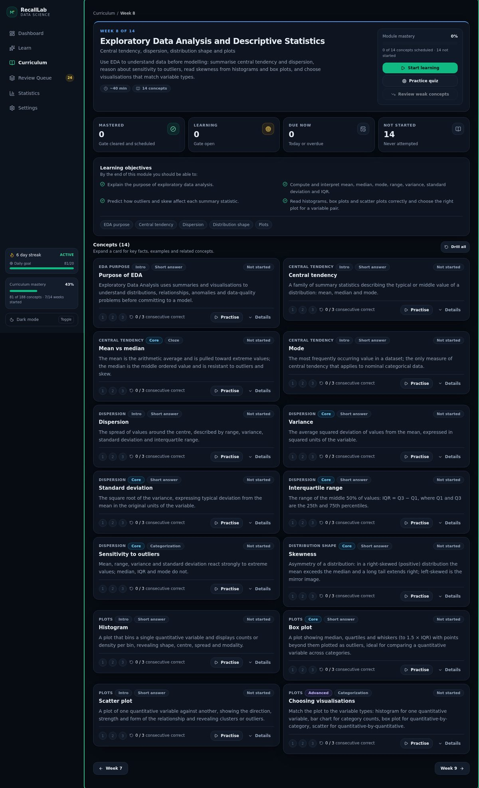
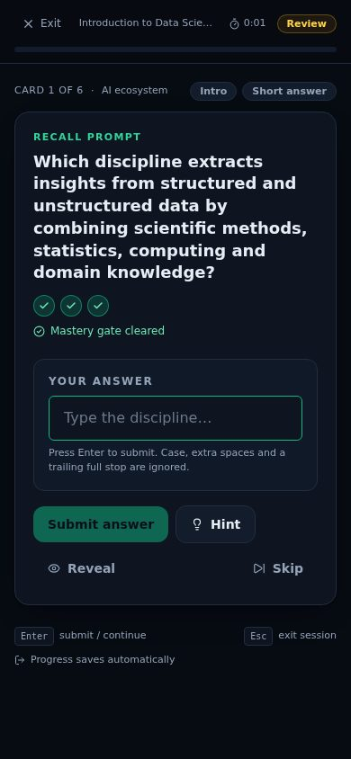
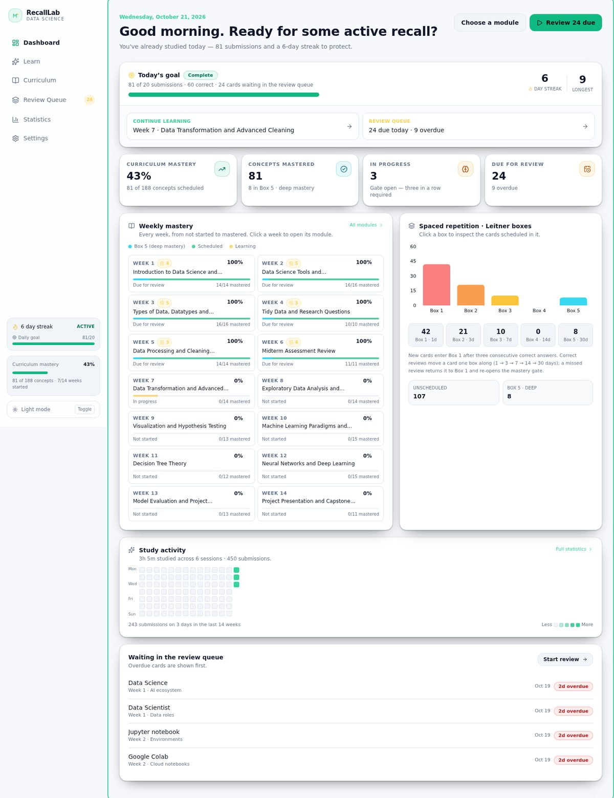

# RecallLab — Data Science Active Recall Trainer

A complete, frontend-only active-recall trainer for an **Introduction to Data Science** course, built
on Chessable's MoveTrainer methodology: exact-answer typing, three-consecutive-correct mastery gates,
and a five-box Leitner spaced-repetition scheduler.

**188 typed curriculum cards across all 14 weeks** — no backend, no API keys, no external services.
All learning content is static data; all progress lives in `localStorage`.



| Curriculum | Study session | Review queue |
| --- | --- | --- |
|  |  |  |

| Statistics | Module page | Mobile |
| --- | --- | --- |
|  |  |  |



---

## Quick start

```bash
git clone https://github.com/<your-username>/RecallLab.git
cd RecallLab
npm ci            # or: npm install   (fallback: npm install --legacy-peer-deps)
npm run dev       # http://localhost:5173
```

Production build and preview:

```bash
npm run build
npm run preview
```

> `npm ci` uses the committed `package-lock.json`. With very recent npm versions (10.x) and Vite 8,
> a plain `npm install` can trip over npm's peer-dependency resolver (`Cannot read properties of null
> (reading 'edgesOut')`). `npm ci` or `npm install --legacy-peer-deps` avoids it. Neither affects the
> app itself — it is purely an npm resolver quirk.

### Optional verification scripts

| Command | What it does |
| --- | --- |
| `npm run check` | 21 pure-logic checks (validation, mastery gate, Leitner scheduler, streaks) **and** a curriculum integrity audit |
| `npm run check:engine` | Engine checks only — no browser needed |
| `npm run check:curriculum` | Card audit: duplicate ids, cloze placeholder/answer mismatch, dangling relations |
| `npm run smoke` | Playwright browser test of the real UI (needs `npm run dev` running) |
| `npm run check:flow` | Browser test of the spaced-repetition rules + export/import round-trip (needs `npm run dev`) |
| `npm run seed` + `npm run visual` | Generates demo progress and screenshots every page (needs the dev server) |

`playwright` is only used by those two optional scripts. The app has no runtime dependency on it, and
`npx playwright install chromium` is required before running them.

---

## What you can do

| Page | Route | Highlights |
| --- | --- | --- |
| **Dashboard** | `/` | Daily goal, streak, mastery overview, all-14-week mastery grid (clickable), Leitner histogram with box filtering, activity heatmap, review preview |
| **Learn** | `/learn` | Session launcher (due reviews, next module, open gates, free practice), engine explanation, weak spots, recent sessions, per-week jump list |
| **Curriculum** | `/curriculum` | Search + week/mastery/review filters, 14 module cards with mastery and study estimates, concept search results |
| **Module** | `/curriculum/week/:n` | Objectives, topic chips, stat tiles, concept cards with expandable detail, related concepts, Start / Practice / Weak-concepts actions, prev/next |
| **Study session** | `/study?...` | Distraction-free drill UI, all three recall modes, mastery counter, hint/reveal, feedback panels, keyboard shortcuts, session summary |
| **Review Queue** | `/review` | Due / Overdue / Upcoming / All tabs, week + box filters, search, box distribution, scheduling rules, "review these cards" |
| **Statistics** | `/statistics` | Mastery ring, accuracy, review success rate, study time, weekly comparison, correct-vs-incorrect history, accuracy trend, Leitner distribution, heatmap, most-missed, weakest topics, session table |
| **Settings** | `/settings` | Theme, sound, daily goal, session size, preferred recall modes, export, import, reset, matching rules |

Every navigation item, filter, chart, toggle, dialog and drill is wired to real state.

---

## The learning engine

### 1. Recall modes (`src/data/weeks/*.ts`, `src/components/drills/`)

* **Short answer** — single-line or multiline input, normalised exact matching.
* **Cloze deletion** — one or more `___` blanks; each blank is validated and marked individually
  (✓ / ✗), and *all* blanks must be correct for the attempt to count.
* **Categorization** — either assign every item to a category (e.g. AI / ML / DL / DS) or select every
  correct option. Partial credit is never a success.

The mode is a property of the card's data, so the UI needs no changes when new cards are added.

### 2. Answer validation (`src/engine/validation.ts`)

Deterministic and deliberately strict:

1. leading/trailing whitespace ignored;
2. case-insensitive comparison;
3. runs of internal whitespace collapsed;
4. one trailing sentence punctuation mark ignored;
5. explicitly configured accepted variants supported (`answers[1..]`);
6. **no fuzzy or edit-distance matching** — near misses are misses.

```ts
isAnswerAccepted('  deep   LEARNING. ', ['Deep Learning', 'DL']) // true
isAnswerAccepted('Deep Learing', ['Deep Learning'])              // false
```

### 3. Three-consecutive-correct mastery gate (`src/engine/scheduler.ts`)

* A correct answer increments the counter (visible as `1 / 3`, `2 / 3`, `3 / 3`).
* An incorrect answer immediately shows the correct answer + explanation, **resets the counter to 0**,
  and the learner stays on the same card until three correct answers *in a row* are achieved.
* Clearing the gate puts the card in **Box 1** with a review **1 day** later.
* Revealing the answer is treated as an incorrect attempt (labelled as such), so it can never skip
  the gate.

### 4. Five-box Leitner scheduler

| Box | Interval |
| --- | --- |
| 1 | 1 day |
| 2 | 3 days |
| 3 | 7 days |
| 4 | 14 days |
| 5 | 30 days |

Rules, all implemented in the pure function `applyAttempt()`:

1. New cards enter Box 1 only after clearing the three-correct gate.
2. A correct scheduled review advances one box and reschedules with the new interval.
3. A correct Box 5 review stays in Box 5 with another 30-day wait.
4. An incorrect scheduled review returns the card to Box 1 **and re-opens the mastery gate**
   (`nextReview = null`), so it cannot advance until the gate is cleared again.
5. Due = scheduled day is today or earlier; overdue cards stay queued and are sorted first.
6. Free practice never moves a box or changes a review date for an already-scheduled card.
7. Dates are stored as local calendar days (`YYYY-MM-DD`), so comparisons are timezone-safe.

`applyAttempt()` is a pure `CardProgress → CardProgress` transition with no React dependency, which is
why it is covered by `npm run check:engine`.

### 5. Streaks and sessions

* A study day is registered on every submission; consecutive local calendar days extend the streak, a
  gap restarts it at 1, and the longest streak is kept. A stale streak displays as 0.
* Each session stores type, label, submissions, correct/incorrect, concepts mastered, reviews
  advanced, cards reset and duration.

---

## Curriculum coverage

All 14 weeks ship as real cards with definition, key facts, example, explanation, hint, related
concepts, difficulty and at least one drill.

| Week | Topic | Cards |
| --- | --- | --- |
| 1 | Introduction to Data Science and the AI Ecosystem | 14 |
| 2 | Data Science Tools and Collaboration | 16 |
| 3 | Types of Data, Datatypes and Acquisition | 16 |
| 4 | Tidy Data and Research Questions | 10 |
| 5 | Data Processing and Cleaning Foundations | 14 |
| 6 | Midterm Assessment Review (Weeks 1–5, cumulative) | 11 |
| 7 | Data Transformation and Advanced Cleaning | 14 |
| 8 | Exploratory Data Analysis and Descriptive Statistics | 14 |
| 9 | Visualization and Hypothesis Testing | 13 |
| 10 | Machine Learning Paradigms and Linear Regression | 15 |
| 11 | Decision Tree Theory | 12 |
| 12 | Neural Networks and Deep Learning | 15 |
| 13 | Model Evaluation and Project Communication | 13 |
| 14 | Project Presentation and Capstone Synthesis | 11 |
| | **Total** | **188** |

Week 6 and Week 14 are cumulative and only use material taught in earlier weeks.

### Adding a card

Append a `Concept` object to `src/data/weeks/weekNN.ts`. Nothing else changes — the dashboard,
statistics, review queue and study engine all derive from that array. Optional dev-time and script
checks catch the common data mistakes:

```bash
npm run check:curriculum
```

---

## Architecture

```
src/
├─ components/            # reusable UI
│  ├─ drills/             # ShortAnswerDrill, ClozeDrill, CategorizationDrill (+ RecallDrill router)
│  ├─ layout/             # AppShell, Sidebar, MobileNav/MobileTopBar, Logo, navItems
│  ├─ ui/                 # ProgressBar/RingProgress, StatTile, Badge, EmptyState, ConfirmDialog, PageHeader
│  ├─ ConceptCard, WeekModuleCard, WeeklyMasteryGrid, LeitnerChart,
│  │  ActivityHeatmap, MasteryCounter, FeedbackPanel, SessionSummary
├─ pages/                 # Dashboard, Learn, Curriculum, ModulePage, StudySession, ReviewQueue, Statistics, Settings
├─ data/                  # curriculum registry + 14 week files (all card content)
├─ engine/                # validation, scheduler, stats, queue builder, streak, persistence (pure TS)
├─ hooks/                 # useStudySession (session state machine)
├─ context/               # AppStateContext (single source of truth + localStorage writes)
├─ types/                 # domain interfaces
└─ utils/                 # date helpers, synthesised sound
```

Design decisions worth knowing:

* **Content, rules and presentation are separated.** `data/` is pure content, `engine/` is pure logic,
  components only render.
* **One state container.** `AppStateContext` owns `{ cards, sessions, streak, settings }`, persists on
  every change, and exposes `recordAttempt`, `recordSession`, `updateSettings`, `importProgress`, …
* **Sessions are a state machine** (`useStudySession`): queue → current card → submit → feedback →
  advance/repeat → summary. A ref lock prevents double submissions from rapid clicks or Enter key
  repeats.
* **Derived analytics only.** `engine/stats.ts` computes every dashboard and statistics number from
  the stored cards; nothing is hard-coded.

---

## Persistence

* Key: `recalllab.datascience.progress.v1` (schema version `1`).
* Persisted: card mastery, consecutive-correct counters, Leitner boxes, next review dates, review
  history, session history, streak, preferences (theme, sound, daily goal, session size, recall
  modes, reveal permission).
* **Defensive loading:** every field is clamped and validated on read; unknown card ids are dropped;
  malformed records are discarded rather than trusted; unparsable JSON is backed up to
  `…progress.v1.corrupt` and the app starts clean instead of crashing.
* **Export** downloads `recalllab-progress-YYYY-MM-DD.json`.
* **Import** validates the shape (`cards` + `settings`), repairs what it can, reports how many records
  were discarded, and replaces progress. Errors are shown inline, never as an alert.
* **Reset** requires confirmation in a modal dialog and keeps preferences.
* No passwords, accounts or personal data are collected or stored.

---

## Accessibility and keyboard use

* Semantic landmarks (`nav`, `main`, `header`, `section`, `fieldset`/`legend`, `table`), labelled
  inputs, `aria-pressed` on toggle buttons, `role="switch"` toggles, `aria-live` feedback regions.
* Correctness and mastery are conveyed with **icons + text** as well as colour (✓/✗, "Mastered gate
  cleared", "2 / 3 consecutive correct").
* Visible focus rings everywhere; focus moves to the feedback "next" button after submitting, to the
  page `<main>` on navigation, and back to the trigger when a dialog closes.
* Destructive actions always use a focus-trapped confirmation dialog (Escape cancels).
* `prefers-reduced-motion` disables animation.
* Study shortcuts: **Enter** submits / continues, **⌘/Ctrl + Enter** submits a multiline answer,
  **Tab** moves between blanks, **Esc** offers to exit the session.

---

## Verification status

* `npm run check` → 21 engine checks + full curriculum audit pass.
* `npm run smoke` → end-to-end browser run with **no console errors**: dashboard, wrong-answer
  feedback, three-correct mastery loop, accurate session summary, reload persistence, cloze
  blank-level grading, categorization completeness, all routes, curriculum search, review queue,
  live statistics, theme persistence, JSON export, mobile layout.
* `npm run check:flow` → box advancement, Box 5 staying put, a missed review resetting to Box 1 with
  the gate re-opened, the gate blocking advancement, export → import round-trip, and rejection of an
  invalid import file.
* `npm run visual` → writes screenshots of every page (dark, light and mobile) to the git-ignored
  `screenshots/` folder; the curated images used in this README live in `docs/screenshots/`.
* `npm run lint` → 0 warnings, 0 errors (oxlint).

---

## Deploying to Netlify

The repository ships a `netlify.toml` at its root, so no dashboard configuration is required:

| Setting | Value |
| --- | --- |
| Build command | `npm run build` |
| Publish directory | `dist` |
| Node version | 20 |
| SPA routing | `/*` → `/index.html` with status **200** (a rewrite, so React Router keeps the URL) |

Also configured: immutable caching for hashed `/assets/*` files, revalidation for `index.html`, and
basic security headers (`nosniff`, referrer policy, same-origin framing).

### Option A — connect the Git repository (recommended)

1. Push the repository to GitHub (see below).
2. In Netlify: **Add new site → Import an existing project → GitHub**, then pick `RecallLab`.
3. Accept the detected settings — they come from `netlify.toml` — and deploy.

Every later push to the default branch redeploys automatically, and pull requests get deploy previews.

### Option B — deploy from the command line

```bash
npm install -g netlify-cli
netlify login
netlify deploy --build            # preview URL
netlify deploy --build --prod     # production
```

### Option C — drag and drop

```bash
npm run build
```

Then drop the generated `dist/` folder onto <https://app.netlify.com/drop>. This works because the app
is fully static: no API keys, environment variables or server functions are needed.

> `NPM_FLAGS = "--legacy-peer-deps"` is set in `netlify.toml` because npm 10's peer resolver can fail
> on the Vite 8 + React 19 tree. The project has no peer-conflicting dependencies, so this is safe.

### Verifying a production build locally

```bash
npm run build
npm run preview                  # serves dist/ at http://localhost:4173
BASE_URL=http://localhost:4173 npm run smoke
```

The full smoke suite passes against the built bundle, including deep links such as
`/curriculum/week/9` — the same paths Netlify rewrites to `index.html`.

## Publishing this repository to GitHub

A local Git history is already initialised with a single commit on `main`. To publish it as a public
repository named `RecallLab`:

**One command (uses `gh` when available, plain Git otherwise)**

```bash
./scripts/publish-to-github.sh <your-github-username>
```

**With the GitHub CLI**

```bash
gh repo create RecallLab --public --source=. --remote=origin --push
```

**Or with plain Git**

```bash
# create an empty public repo named RecallLab on github.com first, then:
git remote add origin https://github.com/<your-username>/RecallLab.git
git push -u origin main
```

Nothing secret is committed: `node_modules/`, `dist/`, generated screenshots, the demo seed file and
editor/OS noise are all covered by `.gitignore`.

## Known scope boundaries

* Frontend only: no server, no database, no auth. Progress is per browser profile.
* Leitner only — explicitly **not** an SM-2 implementation.
* Free practice deliberately cannot advance a scheduled card's box; a card with an open gate can still
  clear that gate through practice, which schedules its first review.
* `localStorage` is best-effort: if storage is full or blocked (private mode), the session keeps
  working and the failure is swallowed silently rather than breaking a drill.
